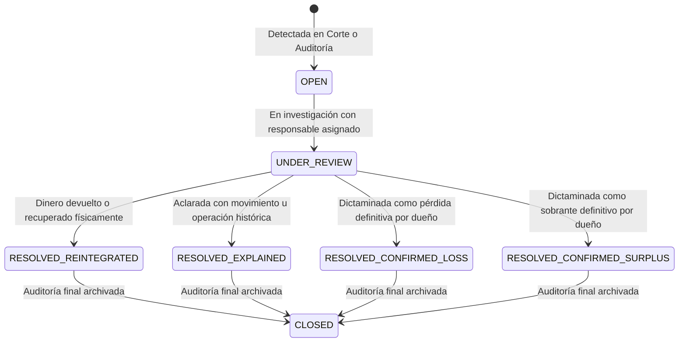

# Cash-Control v2 — Especificación Maestra del Modelo de Dominio Financiero y Operativo

> **Documento:** V2_DOMAIN_SPEC.md  
> **Estado:** Especificación Conceptual y Matemática v2 (Revisión Exhaustiva y Cierre de Reglas)  
> **Versión:** 2.3.0  
> **Rama de trabajo:** `v2/clean-core`  
> **Fecha:** Octubre 2026  
> **Propósito:** Definir con absoluto rigor contable, operativo, de auditoría y de seguridad las entidades, estados, reglas de negocio, modelos matemáticos, garantías transaccionales y matriz de impactos de Cash-Control v2 antes de codificar la base de datos o el backend.

---

## 1. Principios Fundamentales del Sistema

Cash-Control v2 se rige por los siguientes axiomas y reglas invariables de diseño:

### 1.1 Axiomas de Diseño
> **Axioma 1:** *"El saldo representa la realidad actual; el historial explica cómo llegamos a ella."*
> 
> **Axioma 2:** *"El corte fija la realidad financiera operativa del día. Las correcciones posteriores pueden explicar o corregir la historia del corte, pero no deben reescribir destructivamente la realidad de días posteriores ni duplicar impactos financieros."*
> 
> **Axioma 3:** *"Los saldos no son la historia. Los movimientos son la historia. El saldo es el resultado acumulado de esa historia."*
> 
> **Axioma 4:** *"Una misma realidad financiera nunca debe impactar dos veces el Estado Actual."*

### 1.2 Reglas Generales sobre Saldos y Cortes
> **Regla General de Saldos 1:** *"El Estado Actual se modifica únicamente cuando existe un cambio real en la disponibilidad financiera o cuando el corte establece una realidad física/bancaria diferente a la registrada."*
> 
> **Regla General de Saldos 2:** *"Una corrección histórica no debe volver a introducir dinero que ya estaba incluido en el Estado Actual."*
> 
> **Regla General de Saldos 3:** *"Una incidencia puede explicar una diferencia sin modificar nuevamente la tesorería."*
> 
> **Regla General de Cortes:** *"El corte fija la realidad operativa verificada del recurso en ese momento. Para caja: el efectivo contado manda. Para bancos: el saldo real observado en la cuenta manda. Pero en ambos casos: la diferencia respecto al saldo previamente registrado debe conservarse como evento histórico y, cuando corresponda, como incidencia pendiente de explicación."*

---

## 2. Dimensiones Contables del Sistema

El sistema separa con estricta independencia cuatro dimensiones que jamás deben colapsar en un solo número ni confundirse entre sí:

```
┌────────────────────────────────────────────────────────────────────────┐
│ 1. ESTADO ACTUAL (TESORERÍA OPERATIVA REAL)                            │
│    ¿Cuánto dinero líquido existe físicamente y en bancos en este instante?│
│    - Efectivo físico verificado en mostrador (Caja Física)             │
│    - Efectivo apartado en mostrador (Retiros Pendientes en sobre)      │
│    - Saldos operativos reales verificados en cuentas bancarias         │
│    - ÚNICA dimensión con la que se pueden realizar operaciones.        │
└────────────────────────────────────────────────────────────────────────┘

┌────────────────────────────────────────────────────────────────────────┐
│ 2. ESTADO ESPERADO (VISTA DERIVADA DE CONTROL Y RECUPERACIÓN)          │
│    ¿Qué saldo debería alcanzarse si se resolvieran las diferencias?    │
│    - NO es una cuenta de tesorería ni un recurso financiero.          │
│    - NO representa dinero disponible ni utilizable para operar.        │
│    - Vista analítica derivada: Estado Actual y expectativas calificadas│
└────────────────────────────────────────────────────────────────────────┘

┌────────────────────────────────────────────────────────────────────────┐
│ 3. RESULTADO ECONÓMICO (UTILIDAD / PÉRDIDA OPERATIVA DEL SERVICIO)     │
│    ¿Cuánto valor neto ha generado o perdido el negocio por operar?    │
│    - Ingresos por comisiones cobradas                                 │
│    - Pérdidas operativas confirmadas (faltantes dictaminados)         │
│    - Gastos operativos y comisiones bancarias comprobadas             │
│    - Sobrantes confirmados (ingresos extraordinarios dictaminados)     │
└────────────────────────────────────────────────────────────────────────┘

┌────────────────────────────────────────────────────────────────────────┐
│ 4. CAPITAL Y PATRIMONIO DEL DUEÑO (VISTA PRIVADA EXCLUSIVA)           │
│    ¿Cuánto capital aportó el dueño y cuánto ha retirado de ganancias? │
│    - Capital inicial inyectado por el dueño                           │
│    - Inyecciones posteriores de capital                               │
│    - Retiros físicos de utilidades (Owner Drawings)                   │
│    - Utilidad neta retenida acumulada en el patrimonio                │
│    - PRIVADA: Los empleados no tienen visibilidad de esta dimensión.  │
└────────────────────────────────────────────────────────────────────────┘
```

---

## 3. Estado Actual vs. Estado Esperado

### 3.1 Estado Actual (Realidad Operativa)
* Representa el dinero comprobado que existe físicamente en las charolas/sobres y operativamente en las cuentas de banco.
* **Regla de Continuidad Operativa:** El corte establece la realidad verificada del recurso. **El siguiente turno/día comienza estrictamente con esa realidad.**
  - *Ejemplo en Caja:* Si el sistema calculaba $\$12,800$ y físicamente se contaron $\$12,500$ (faltante de $-\$300$), el saldo actual de la caja se fija en $\$12,500$. El siguiente turno abre con $\$12,500$.
  - *Ejemplo en Banco:* Si el sistema registraba $\$50,000$ y la aplicación bancaria muestra $\$49,500$ (diferencia de $-\$500$), el saldo actual del banco se fija en $\$49,500$.

### 3.2 Estado Esperado: Definición como Vista Derivada
* **Naturaleza Estricta:** El Estado Esperado **NO es una cuenta contable de activo**, NO es un recurso financiero y **NO es dinero disponible**.
* **Prohibición Operativa:** Queda terminantemente prohibido utilizar el Estado Esperado para autorizar, respaldar o despachar depósitos, retiros, transferencias, fondeos, pagos o gastos.
* **Función:** Es una **métrica analítica derivada de control** que le indica al dueño y a los auditores el saldo al que debería retornar el activo si todas las diferencias cuantificadas pendientes se aclararan o recuperaran satisfactoriamente.

### 3.3 Modelo Matemático del Estado Esperado
Para evitar distorsiones donde restar o sumar algebraicamente un número negativo produzca resultados invertidos, el Estado Esperado se define como:

$$\text{Estado Esperado} = \text{Estado Actual} - \sum_{i \in \mathcal{I}_{\text{calificadas}}} \Delta_i$$

Donde $\Delta_i$ representa el **impacto firmado registrado en el corte sobre el recurso** para la incidencia $i$:
* Para un **faltante** de $\$300$: el recurso bajó en el corte, por lo que su desviación firmada es $\Delta = -\$300$.
  $$\text{Estado Esperado} = \$12,500 - (-\$300) = \$12,500 + \$300 = \$12,800$$
* Para un **sobrante** de $\$300$: el recurso subió en el corte con dinero no aclarado, por lo que su desviación firmada es $\Delta = +\$300$.
  $$\text{Estado Esperado} = \$13,100 - (+\$300) = \$13,100 - \$300 = \$12,800$$
* Para una **diferencia bancaria no aclarada** de $-\$500$: el banco se fijó en $\$49,500$ ($\Delta = -\$500$).
  $$\text{Estado Esperado} = \$49,500 - (-\$500) = \$50,000$$

### 3.4 Condiciones Obligatorias para que una Incidencia Califique ($\mathcal{I}_{\text{calificadas}}$)
Una incidencia **NO se incluye automáticamente** en el cálculo del Estado Esperado. Debe satisfacer simultáneamente las siguientes 4 condiciones:

1. **Cuantificada:** Posee un importe numérico monetario exacto probado (`amount > 0`). Si una incidencia es cualitativa, informativa o está en proceso de determinación de monto, $\Delta = 0$ y **no afecta el Estado Esperado**.
2. **Dirección Económica Clara:** Está tipificada inequívocamente como faltante ($-\Delta$), sobrante ($+\Delta$) o descuadre bancario observado ($-\Delta$ o $+\Delta$).
3. **Expectativa Razonable de Resolución:** Representa una diferencia que razonablemente debe explicarse, recuperarse o resolverse administrativamente (no es una nota de bitácora).
4. **Estado Activo Pendiente:** Se encuentra estrictamente en estado `OPEN` o `UNDER_REVIEW`.

### 3.5 Salida de la Expectativa y Convergencia de Saldos
* **Si el dueño confirma una pérdida definitiva (`RESOLVED_CONFIRMED_LOSS`):**
  - La incidencia sale de $\mathcal{I}_{\text{calificadas}}$ porque ya no hay expectativa de recuperar el dinero.
  - El Estado Esperado converge naturalmente al Estado Actual (ej. de $\$10,000$ baja a $\$9,200$).
  - El Resultado Económico registra la pérdida de $-\$800$.
  - La tesorería **NO vuelve a cambiar** (permanece en $\$9,200$).
* **Si el dinero es realmente reintegrado (`RESOLVED_REINTEGRATED`):**
  - Entra dinero físico real: el Estado Actual sube a $\$10,000$.
  - La incidencia se marca como resuelta y sale de $\mathcal{I}_{\text{calificadas}}$.
  - El Estado Esperado se mantiene en $\$10,000$. Ambos saldos convergen de forma limpia.

---

## 4. Resultado Económico vs. Tesorería

La tesorería y el resultado económico son dimensiones ortogonales:

| Evento | ¿Afecta Tesorería (Estado Actual)? | ¿Afecta Resultado Económico? | Justificación Contable |
| :--- | :---: | :---: | :--- |
| **Cobro de Comisión** | Sí ($+\text{Caja/Banco}$) | Sí ($+\text{Ingreso}$) | Generación de valor genuino por el servicio prestado. |
| **Transferencia Caja $\rightarrow$ Banco** | No neto ($-\text{Caja}, +\text{Banco}$) | **No ($0$)** | Simple reubicación física de activos de tesorería. |
| **Aportación de Capital del Dueño** | Sí ($+\text{Caja/Banco}$) | **No ($0$)** | Inyección patrimonial; no es ganancia operativa del negocio. |
| **Retiro de Utilidades del Dueño** | Sí ($-\text{Caja/Banco}$) | **No ($0$)** | Distribución de dividendos; no es un gasto operativo. |
| **Faltante Detectado en Corte** | Sí ($-\text{Caja}$ a la realidad) | **No de inmediato ($0$)** | Se registra la realidad física; la diferencia queda como incidencia. |
| **Pérdida Confirmada por Dueño** | **No ($0$)** (ya ajustada en corte) | Sí ($-\text{Pérdida/Gasto}$) | Se asienta el quebranto económico sin duplicar la salida de tesorería. |
| **Sobrante Confirmado Extraordinario** | **No ($0$)** (ya sumado en corte) | Sí ($+\text{Ingreso Extraord.}$)| Se reconoce el beneficio económico sin duplicar la entrada física. |

---

## 5. El Proceso Integrado de Corte de Caja y Auditoría

> **Regla Fundamental:** *Corte de caja y Auditoría bancaria conforman un único proceso operativo integrado. No son dos sistemas separados.*

### 5.1 Flujo Operativo Flexible
El responsable/auditor inicia el proceso y puede comenzar por caja o por bancos según el flujo operativo de la sucursal:

```
[ INICIAR CORTE Y AUDITORÍA ]
              │
              ▼
    [ Elección de Inicio ]
     ├── Opción A: Iniciar por CAJA FÍSICA
     └── Opción B: Iniciar por BANCOS
              │
              ▼
   ┌────────────────────────────────────────────────────────┐
   │ 1. Arqueo Físico de Caja:                              │
   │    - Saldo Teórico vs. Conteo Real (Charola + Sobres)  │
   │    - Cálculo de exacto, faltante o sobrante            │
   │    - El Estado Actual se fija a la cantidad contada    │
   │    - Registro de incidencia por cualquier diferencia   │
   └────────────────────────────────────────────────────────┘
              │
              ▼
   ┌────────────────────────────────────────────────────────┐
   │ 2. Conciliación y Auditoría Bancaria por Cuenta:       │
   │    - Consulta de saldo real en banca en línea          │
   │    - El Estado Actual bancario se fija al saldo real   │
   │    - Revisión movimiento a movimiento:                 │
   │      Depósitos | Retiros | OTRO                        │
   │    - Dictamen de cada movimiento observado             │
   └────────────────────────────────────────────────────────┘
              │
              ▼
   ┌────────────────────────────────────────────────────────┐
   │ 3. Identificación y Formalización de Incidencias:      │
   │    - Operaciones faltantes encontradas                 │
   │    - Movimientos bancarios no reconocidos              │
   │    - Asignación de responsable e inicio de SLA         │
   └────────────────────────────────────────────────────────┘
              │
              ▼
   ┌────────────────────────────────────────────────────────┐
   │ 4. Determinación de Resultado del Corte:               │
   │    - Balance de caja física verificado                 │
   │    - Balance bancario verificado                       │
   │    - Relación de incidencias abiertas                  │
   └────────────────────────────────────────────────────────┘
              │
              ▼
     [ FINALIZAR CORTE ] 
     (Estado: COMPLETED o COMPLETED_WITH_ISSUES)
```

---

## 6. Corte y Auditoría de Caja Física

1. El sistema presenta el **Saldo Teórico Esperado**.
2. El cajero/auditor cuenta físicamente el dinero en presencia de los testigos y captura la `cantidad_contada`:
   - Efectivo físico libre en charola (Disponible operativo).
   - Efectivo físico apartado en sobres (Retiros de clientes pendientes en cajón).
3. El sistema calcula en tiempo real:
   - `exacto`: Diferencia $= 0$.
   - `shortage` (faltante): Contado $<$ Esperado ($\Delta < 0$).
   - `surplus` (sobrante): Contado $>$ Esperado ($\Delta > 0$).
4. **Acciones Inmediatas al Corte:**
   - La caja física **fija su Estado Actual en la cantidad contada**.
   - Se crea una `Incidencia` formal permanente vinculada al corte por la diferencia.
   - **NO se convierte automáticamente la diferencia en pérdida ni en ganancia económica.**
   - El siguiente turno arranca con la cantidad contada real.

---

## 7. Conciliación Bancaria y Auditoría Individual

> **Regla Definitiva:** *El corte bancario fija el Estado Actual al saldo realmente verificado en la cuenta bancaria, pero toda diferencia debe conservar evidencia, causa o incidencia asociada.*

### 7.1 Fijación del Saldo Bancario y Trazabilidad Obligatoria
Si existe discrepancia entre Cash-Control y la banca en línea, **el saldo bancario real observado manda sobre el sistema**, pero jamás mediante una alteración silenciosa. Debe quedar un acta de conciliación estructurada:

```text
Saldo anterior registrado en sistema: $50,000
Saldo real observado en cuenta bancaria: $49,500
Diferencia cuantificada:               -$500
Estado Actual posterior al corte:      $49,500
Causa:                                 Pendiente de determinar (Incidencia creada)
```

### 7.2 Tratamiento de la Diferencia Posterior al Corte
* **Si se comprueba una causa legítima (ej. comisión bancaria o terminal):**
  - La incidencia se marca como `RESOLVED_EXPLAINED`.
  - Se genera un movimiento de categoría `OTRO` (`bank_fee`).
  - Resultado Económico registra el gasto por $-\$500$.
  - **El Estado Actual permanece en $\$49,500$** (el movimiento explica la diferencia; NO vuelve a descontar el dinero).
* **Si la diferencia permanece sin aclarar:**
  - La incidencia queda en estado `UNDER_REVIEW`.
  - El Estado Actual permanece en $\$49,500$ (reflejando la realidad bancaria líquida).
  - El Resultado Económico permanece en $\$0$ pendiente de investigación.

### 7.3 Categorías de Revisión y Categoría "OTRO"
La auditoría se realiza banco por banco clasificando los movimientos en:
* **Depósitos:** Entradas de efectivo en ventanilla enviadas por clientes.
* **Retiros:** Transferencias SPEI enviadas por clientes para retirar efectivo en mostrador.
* **OTRO:** Movimientos ajenos a clientes:
  - Cobros y liquidaciones de terminal POS / tarjeta.
  - Comisiones bancarias por manejo de cuenta o transferencias SPEI.
  - Pagos de servicios del local (luz, agua, internet) cargados a la cuenta.
  - Rendimientos / intereses devengados.
  - Ajustes directos de la institución bancaria.

### 7.4 Dictamen Individual de Movimientos Auditados
Cada movimiento del estado de cuenta bancario recibe uno de los siguientes estados:
1. `COINCIDE`: Existe en Cash-Control con importe, folio y cuentas idénticas.
2. `FALTA_EN_SISTEMA`: Ocurrió en el banco pero no fue capturado en Cash-Control.
3. `DATOS_INCORRECTOS`: Registrado con error tipográfico en importe, referencia o titular.
4. `MOVIMIENTO_OTRO`: Gasto o ajuste bancario (origina movimiento administrativo de conciliación).
5. `GENERA_INCIDENCIA`: Movimiento no identificado que exige investigación formal.

Todo movimiento revisado queda sellado con `is_audited = true`, timestamp y usuario auditor.

---

## 8. Tratamiento de Operaciones Encontradas durante la Auditoría

### 8.1 Caso 1: Dinero NO incluido en el Saldo (`AUDIT_ADJUSTMENT`)
* Ocurrió un retiro o depósito real que no fue registrado en el sistema, y el saldo de la cuenta o caja estaba desfasado porque faltaba aplicar esa operación.
* **Regla:** Se utiliza exactamente el mismo flujo canónico de captura/confirmación que una operación normal.
* **Distinción:** Se etiqueta con `origin = 'AUDIT_ADJUSTMENT'`.
* **Impacto:** Afecta la tesorería (aplica el débito/crédito pendiente), registra la comisión correspondiente y vincula el registro a la auditoría activa.

### 8.2 Caso 2: Dinero YA incluido en el Saldo Contado/Conciliado (`AUDIT_RECLASSIFICATION`)
* **Regla de Regularización y No Duplicación:** Si durante la auditoría se descubre una operación que no estaba en el sistema, pero el dinero **ya fue contado en el corte o ya formaba parte del saldo real verificado del banco**, **QUEDA TERMINANTEMENTE PROHIBIDO VOLVER A SUMAR O RESTAR EL DINERO DE LA TESORERÍA**.
* **Propósito de `AUDIT_RECLASSIFICATION`:**
  - Es una **reclasificación y regularización histórica con impacto de tesorería neto $= 0$**.
  - Corrige la trazabilidad histórica de folios y clientes.
  - Registra el ingreso por comisión ganada en el Resultado Económico.
  - Genera un contra-asiento de neutralización en tesorería para evitar duplicar el saldo maestro.
* *Ejemplo:* Banco verificado en $\$50,000$. Se detecta un depósito no registrado de $\$1,000$ con comisión de $\$50$.
  - Saldo del banco: **permanece en $\$50,000$**.
  - Resultado Económico: se acredita la comisión de $+\$50$.
  - Se vincula a la auditoría con evidencia de respaldo.

---

## 9. Reintegraciones, Recuperaciones y Dinero sin Origen

### 9.1 Dinero Realmente Reintegrado o Recuperado
* Si en un corte previo se registró un faltante de $-\$800$ y la caja quedó en $\$9,200$, y días después el cajero o cliente devuelve físicamente los $\$800$:
* **Mecánica:**
  - El Estado Actual sube físicamente: $\$9,200 \rightarrow \$10,000$.
  - Se genera un asiento ledger de tesorería tipo `discrepancy_recovery`.
  - La incidencia original **NO se borra ni se sobreescribe**. Pasa a estado `RESOLVED_REINTEGRATED`.
  - El historial conserva: `Faltante original: -$800`, `Monto devuelto: +$800`, quién reintegró, fecha y turno activo.
  - El impacto financiero ocurre únicamente una vez.

### 9.2 Dinero Encontrado sin Origen Identificado (`REINTEGRO_SIN_ORIGEN`)
* Si aparece dinero físico en el mostrador o cajón y no existe evidencia de qué cliente u operación provino:
* **Prohibición:** Queda prohibido inventar una operación simulada de cliente.
* **Mecánica:**
  - Se registra formalmente como `REINTEGRO_SIN_ORIGEN` (`unidentified_cash_recovery`).
  - **Aumenta el Estado Actual** de la caja física (porque el dinero existe físicamente y se puede operar).
  - **Crea una incidencia** de tipo sobrante no identificado en estado `UNDER_REVIEW`.
  - **Resultado Económico $= \$0$** (no es ganancia hasta dictamen posterior).
  - Conserva quién lo halló, cuándo, monto exacto y expediente abierto de investigación.
  - Si con posterioridad se esclarece el origen, se reclasifica mediante un proceso trazable.

---

## 10. Ciclo de Vida de Incidencias, Turnos y Políticas de Operación

### 10.1 Ciclo de Vida Inmutable de Incidencias
Las incidencias son entidades históricas permanentes. **Jamás se eliminan de la base de datos.**



### 10.2 Regla de Apertura del Siguiente Turno
* **La realidad física manda:** Si un turno cerró con un faltante severo (ej. $-\$5,000$) y la caja física verificada quedó en $\$20,000$, el responsable del siguiente turno **recibe exactamente $\$20,000$**.
* **No transmisión de deuda:** La incidencia de $-\$5,000$ pertenece al turno y custodios anteriores. No se transfiere como saldo negativo ni como responsabilidad financiera al nuevo cajero.
* **Política por Defecto:** **NO bloquear la apertura del siguiente turno** únicamente por la existencia de incidencias pendientes del turno previo.
* Se emiten alertas inmediatas al dueño y se mantiene la visibilidad de la incidencia en el panel de control.

### 10.3 SLAs y Plazos de Revisión Recomendados
* **Caja física:** Revisión sugerida dentro de las **72 horas**.
* **Bancos:** Revisión sugerida dentro de los **7 días** naturales.
* **Comportamiento del Sistema:** Los plazos son **alertas y recomendaciones configurables**. El sistema **NUNCA debe**:
  - Cerrar automáticamente una incidencia.
  - Convertirla automáticamente en pérdida o gasto.
  - Eliminarla u ocultarla.
  - Modificar los saldos de tesorería.

### 10.4 Política de Diferencias Menores (Tolerancia de Centavos)
* **Regla Inicial:** **Todo descuadre debe conservarse y ser trazable.**
* Incluso diferencias mínimas (ej. $\$0.50$ por redondeo de monedas) deben quedar registradas como hecho histórico inmutable en el corte.
* No se implementará por ahora absorción o condonación automática; la historia financiera permanece íntegra.

---

## 11. Diferencias Detectadas vs. Pérdidas y Sobrantes Confirmados

### 11.1 Faltantes en Corte
1. **Detección (Corte):** Faltante de $-\$800$.
   - Tesorería: La caja baja $-\$800$ (fijada a lo contado).
   - Incidencia: Nace en `OPEN` por $-\$800$.
   - Resultado Económico: **$\$0$ (Pendiente)**.
2. **Dictamen Posterior (Dueño):** El dueño confirma la pérdida definitiva.
   - Incidencia: Pasa a `RESOLVED_CONFIRMED_LOSS`.
   - Resultado Económico: Registra gasto/pérdida por $-\$800$.
   - Tesorería: **$\$0$ de cambio** (ya se había descontado en el corte).

### 11.2 Sobrantes en Corte
1. **Detección (Corte):** Sobrante de $+\$300$.
   - Tesorería: La caja sube $+\$300$ (fijada a lo contado).
   - Incidencia: Nace en `OPEN` por $+\$300$.
   - Resultado Económico: **$\$0$ (Pendiente)**.
2. **Dictamen Posterior (Dueño):** El dueño confirma que no hay reclamo pendiente y dictamina sobrante definitivo.
   - Incidencia: Pasa a `RESOLVED_CONFIRMED_SURPLUS`.
   - Resultado Económico: Se acredita a ingresos extraordinarios $+\$300$.
   - Tesorería: **$\$0$ de cambio** (el dinero físico ya estaba en caja).

---

## 12. Corrección No Destructiva de Operaciones y Política de Comisiones

### 12.1 Principio de Corrección Inmutable
1. La UI ofrece la acción *"Editar operación"*.
2. El backend ejecuta atómicamente:
   $$\text{Operación Original (status: corrected)} \longrightarrow \text{Contra-Asiento de Reversión} \longrightarrow \text{Nueva Operación Reemplazante}$$
3. Ambas operaciones quedan enlazadas por el registro inmutable de `operation_corrections`.

### 12.2 Política de Corrección de Comisiones
* **Regla:** *La comisión final de una operación corregida debe corresponder a la operación correcta según las reglas tarifarias vigentes al momento de la operación.*
* *Ejemplo:*
  - Operación original: Retiro por $\$500$, comisión cobrada $\$20$.
  - Corrección posterior: El retiro real fue de $\$300$, cuya tarifa vigente corresponde a $\$15$.
  - Procedimiento:
    1. Se revierte la operación original (reversa de $\$500$ de capital y $\$20$ de comisión).
    2. Se crea la nueva operación correcta ($\$300$ de capital y $\$15$ de comisión).
    3. El Resultado Económico ajusta limpiamente la diferencia neta ($-\$5$ en comisiones ganadas).
    4. La tesorería ajusta los $\$200$ de diferencia de capital y los $\$5$ de diferencia de comisión entregada/cobrada.
    5. Todo el historial de tarifas y folios permanece inalterado.

---

## 13. Movimientos Internos, Fondeos y Capital del Dueño

### 13.1 Transferencias Internas
* Movimientos entre Caja y Banco o entre Bancos (Caja $\leftrightarrow$ Banco, Banco A $\leftrightarrow$ Banco B).
* Solo reubican los saldos en `treasury_resources`.
* Resultado Económico $= 0$.
* Capital del Dueño $= 0$.

### 13.2 Fondeos
* Fondeo en turno `OPEN`: Edición controlada generando registro inmutable en `administrative_movement_edits`.
* Fondeo en turno `CLOSED`: Prohibido editar el turno cerrado; se aplica un movimiento correctivo compensatorio en el turno activo.

### 13.3 Aportaciones vs. Retiros de Utilidades del Dueño
* **Aportación de Capital:**
  - Tesorería: $+\$5,000$
  - Capital del Dueño: $+\$5,000$
  - Resultado Económico: $\$0$ (no es venta ni servicio).
* **Retiro de Utilidades (Owner Drawings):**
  - Tesorería: $-\$2,000$
  - Utilidades Retenidas Acumuladas: $-\$2,000$
  - Resultado Económico: $\$0$ (no es pérdida ni gasto operativo del negocio).

---

## 14. Matriz Conceptual de Impactos Financieros y de Auditoría

Esta matriz gobierna de forma exhaustiva todos los eventos del sistema:

| Evento | (1) ¿Afecta Estado Actual? | (2) ¿Afecta Estado Esperado? | (3) ¿Afecta Resultado Económico? | (4) ¿Genera Incidencia? | (5) ¿Es Dinero Nuevo Real? | (6) ¿Modifica Saldo Existente? | (7) ¿Ligado a un Corte? | (8) ¿Ligado a Incidencia? | (9) ¿Reversible / Corregible? | (10) Historial a Conservar |
| :--- | :---: | :---: | :---: | :---: | :---: | :---: | :---: | :---: | :---: | :---: |
| **Depósito de Cliente** | Sí ($+\text{Caja}, -\text{Banco}$) | No | Sí ($+\text{Comisión}$) | No | Sí (en caja) | Sí | Sí (turno) | No | Sí (vía reversión atómica) | Folio, cliente, cuentas, comisión, cajero, turno, timestamp |
| **Retiro de Cliente** | Sí ($+\text{Banco}, -\text{Caja}$) | No | Sí ($+\text{Comisión}$) | No | Sí (en banco) | Sí | Sí (turno) | No | Sí (vía reversión atómica) | Folio, cliente, cuentas, comisión, cajero, turno, timestamp |
| **Comisión Cobrada** | Sí (según medio de cobro) | No | Sí ($+\text{Ingreso}$) | No | Sí | Sí | Sí (turno) | No | Sí (con la op) | Regla aplicada, snapshot tarifario, monto, fecha |
| **Transferencia Interna (Caja $\leftrightarrow$ Banco)** | Sí (redistribución entre recursos) | No | **No ($0$)** | No | No | Sí | Sí (turno) | No | Sí (contra-movimiento) | Recurso origen, recurso destino, monto, actor, justificación |
| **Fondeo (Ingreso Interno Efectivo)** | Sí ($+\text{Recurso}$) | No | **No ($0$)** | No | Sí | Sí | Sí (turno) | No | Sí (edición controlada en turno) | Recurso, monto, actor, justificación, histórico de ediciones |
| **Gasto Operativo (de Caja o Banco)** | Sí ($-\text{Recurso}$) | No | Sí ($-\text{Gasto}$) | No | No (egreso) | Sí | Sí (turno) | No | Sí (contra-movimiento) | Recurso pagador, comprobante, concepto, cajero, turno |
| **Aportación de Capital del Dueño** | Sí ($+\text{Recurso}$) | No | **No ($0$)** | No | Sí | Sí | Sí (turno) | No | Sí (contra-movimiento firmado) | Cuenta receptora, monto, actor (dueño), fecha |
| **Retiro de Utilidad del Dueño** | Sí ($-\text{Recurso}$) | No | **No ($0$)** (baja retención) | No | No (salida) | Sí | Sí (turno) | No | Sí (contra-movimiento firmado) | Cuenta pagadora, monto, actor (dueño), fecha |
| **Faltante en Corte de Caja** | Sí ($-\text{Caja}$ fijada a lo contado) | Sí (espera recuperarse: $-\Delta$) | **No ($0$)** (pendiente dictamen) | **Sí** | No | Sí | **Sí** (corte caja) | **Sí** (es el origen) | No el corte; sí la incidencia | Teórico, contado, diferencia, cajero, auditor, turno |
| **Sobrante en Corte de Caja** | Sí ($+\text{Caja}$ fijada a lo contado) | Sí (espera aclararse: $+\Delta$) | **No ($0$)** (pendiente dictamen) | **Sí** | Sí (físico en mano) | Sí | **Sí** (corte caja) | **Sí** (es el origen) | No el corte; sí la incidencia | Teórico, contado, diferencia, cajero, auditor, turno |
| **Conciliación Bancaria (Corte de Banco)** | **Sí (Fija saldo a lo observado en banco)** | Sí (si hay diferencia: $\pm\Delta$) | **No de inmediato ($0$)** | **Sí (si hubo diferencia)** | No (ajuste a realidad) | **Sí (fija nuevo saldo)** | **Sí** (corte banco) | **Sí (si hay diferencia)** | No el corte; sí la incidencia | Saldo previo, saldo observado, diferencia, auditor, evidencia |
| **Ajuste Bancario Confirmado (OTRO)** | **No** (ya fijado en corte previo) | Sí (resuelve expectativa) | Sí ($-\text{Comisión/Gasto bancario}$) | **Sí** (la resuelve) | No | **No** (evita duplicar) | Sí (turno activo) | **Sí** (asociada) | Sí (contra-movimiento) | Acta de conciliación, movimiento administrativo, justificación |
| **Op. Faltante Encontrada (No en Saldo)** | Sí ($+\text{o} -\text{según op}$) | No | Sí ($+\text{Comisión}$) | Opcional | Sí | Sí | Sí (auditoría) | Opcional | Sí (vía reversión atómica) | `origin: AUDIT_ADJUSTMENT`, corte auditor, evidencia, autor |
| **Op. Encontrada YA en Saldo** | **No ($0$)** (Tesorería neutra) | Sí (explica descuadre) | Sí ($+\text{Comisión}$) | **Sí** (la aclara) | No | **No** (evita duplicar) | Sí (auditoría) | **Sí** (la aclara) | Sí (vía reclasificación) | `origin: AUDIT_RECLASSIFICATION`, corte, regularización |
| **Dinero Realmente Reintegrado** | Sí ($+\text{Caja}$ física devuelta) | Sí (resuelve expectativa) | **No ($0$)** (salvo pérdida previa) | **Sí** (la resuelve) | Sí | Sí | Sí (turno activo) | **Sí** (la resuelve) | No destructivo | Incidencia original, actor que devuelve, fecha, turno |
| **Dinero Hallado sin Origen** | Sí ($+\text{Caja}$ física existente) | Sí (abre expectativa) | **No ($0$)** | **Sí** (tipo sobrante) | Sí | Sí | Sí (turno activo) | **Sí** (la crea) | Sí (reclasificación posterior) | Arqueo, quién halló, monto, expediente de investigación |
| **Pérdida Confirmada por Dueño** | **No ($0$)** (ya ajustada en corte) | Sí (sale de expectativa) | Sí ($-\text{Pérdida}$) | **Sí** (la cierra) | No | **No** (evita duplicar) | No (es dictamen) | **Sí** (la resuelve) | No reversible | Incidencia asociada, dictamen, dueño, fecha, notas |
| **Corrección de Operación y Comisión** | Sí (ajusta diferencial neto) | No | Sí (ajusta tarifa correcta) | Opcional | Según diferencial | Sí | Sí (turno activo) | Opcional | Sí | Operación original, reversión, reemplazante, tarifa, motivo |

---

## 15. Catálogo de Entidades para el Diseño Relacional v2

1. **`businesses`:** Sucursal / Inquilino multi-empresa.
2. **`users`:** Cuentas Supabase Auth.
3. **`business_members`:** Perfiles con roles (`owner`, `employee`) y PIN criptográfico.
4. **`workstations`:** Terminales físicas de mostrador.
5. **`shifts`:** Turnos de custodia y cortes consolidados (`status`: `OPEN`, `COMPLETED`, `COMPLETED_WITH_ISSUES`).
6. **`shift_participants`:** Registro de asistencia y cajeros en turno.
7. **`shift_custody_handovers`:** Entregas-recepciones bilaterales firmadas por PIN.
8. **`treasury_resources`:** Cuentas de efectivo físico y cuentas bancarias operativas.
9. **`economic_accounts`:** Cuentas de resultado (comisiones ganadas, pérdidas dictaminadas, gastos, utilidades retenidas, capital aportado).
10. **`operations`:** Operaciones canónicas de depósito y retiro de clientes (`origin`: `NORMAL`, `AUDIT_ADJUSTMENT`, `AUDIT_RECLASSIFICATION`).
11. **`operation_corrections`:** Vínculo inmutable de reversión y reemplazo.
12. **`administrative_movements`:** Fondeos, gastos, aportaciones y retiros de utilidades del dueño.
13. **`administrative_movement_edits`:** Historial inmutable de ediciones de fondeos en turnos abiertos.
14. **`financial_ledger_entries`:** Libro mayor de tesorería (partidas de activos líquidos reales).
15. **`economic_ledger_entries`:** Libro mayor de resultado económico (ingresos, pérdidas y patrimonio).
16. **`incidences`:** Entidad universal permanente de control de faltantes, sobrantes, dineros no identificados y descuadres bancarios.
17. **`incidence_resolutions`:** Historial de dictámenes y eventos de resolución de incidencias.
18. **`bank_audits`:** Actas de conciliación bancaria con saldo registrado, saldo observado y diferencia.
19. **`bank_audit_items`:** Auditoría movimiento por movimiento con categorización (Depósitos, Retiros, OTRO) y dictamen (`COINCIDE`, `FALTA_EN_SISTEMA`, etc.).
20. **`commission_rules`:** Tarifarios versionados e inmutables.
21. **`audit_events`:** Pistas de auditoría forense de seguridad.
